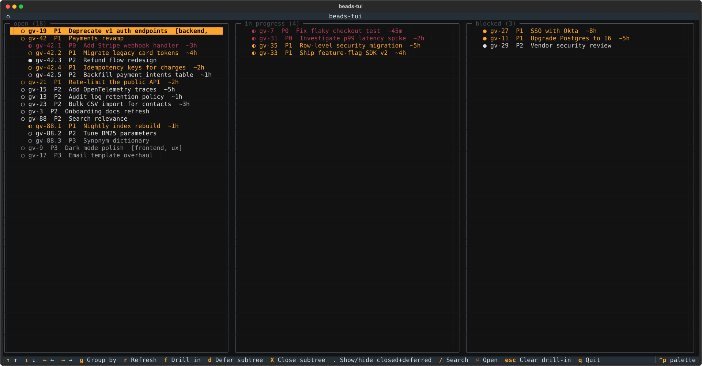
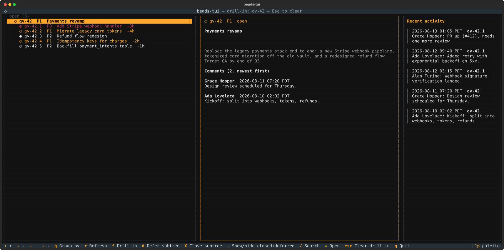
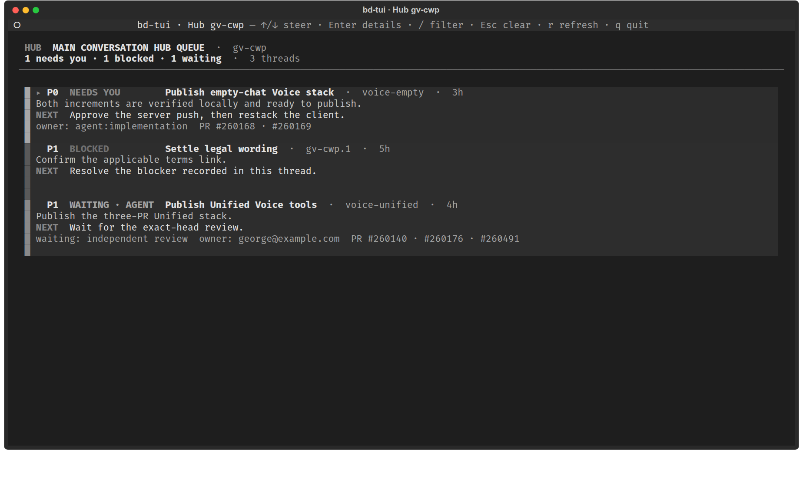

# bd-tui

A keyboard-driven **kanban TUI** for the [beads](https://github.com/gastownhall/beads)
(`bd`) issue tracker. Read-only for issue data, with two focused write actions:
**adding a comment** and **deferring / closing whole subtrees**.

Built with [Textual](https://textual.textualize.io/). Talks to your beads database
entirely through the `bd` CLI, so it works with whatever backend `bd` is configured
for.

## Screenshots

Kanban board — grouped by status, with epics and their subtasks:



Drill into a ticket (`f`) for a live detail pane plus a group **activity feed** of
the latest comments (click an entry to jump to that ticket):



Hub dashboard — a flat, human-readable control panel for a coordinator Bead:



_(Sample data.)_

## Requirements

- Python **3.10+**
- The **`bd`** CLI on your `PATH`

### Compatibility

Developed and tested against **beads `bd` v1.2.2** (from
[`gastownhall/beads`](https://github.com/gastownhall/beads)). v1.2.2+ is
recommended: earlier versions (≤ 0.60) have a Dolt-backend bug where
`bd comments … --json` fails, which would break the detail and activity panes.
bd-tui only uses stable `bd` subcommands (`list`, `comments`, `update`, `close`),
so newer 1.x releases are expected to work too.

## Install

Using [uv](https://docs.astral.sh/uv/) (recommended) or
[pipx](https://pipx.pypa.io/) — either installs `bd-tui` into its own isolated
environment:

```bash
uv tool install git+https://github.com/gevou/bd-tui.git
# or
pipx install git+https://github.com/gevou/bd-tui.git
```

One-liner:

```bash
curl -fsSL https://raw.githubusercontent.com/gevou/bd-tui/main/install.sh | bash
```

To choose where the `bd-tui` executable goes, pass `--bin-dir` (or set
`BD_TUI_BIN_DIR`):

```bash
curl -fsSL .../install.sh | bash -s -- --bin-dir ~/bin
curl -fsSL .../install.sh | BD_TUI_BIN_DIR=~/bin bash
```

With a direct `uv`/`pipx` install, the same is controlled by their own settings
(`UV_TOOL_BIN_DIR` for uv; `PIPX_BIN_DIR` / `PIPX_HOME` for pipx).

## Usage

```bash
bd-tui                    # columns grouped by status (default)
bd-tui --group priority   # or: label
bd-tui --poll 0           # disable the 15s auto-refresh
bd-tui --hub gv-cwp       # focused coordinator Hub dashboard
```

`bd-tui` finds your database the same way `bd` does (it walks up from the current
directory to a `.beads/`). If your database lives elsewhere, point at it with the
standard beads environment variable:

```bash
export BEADS_DIR=/path/to/.beads
```

### Hub dashboard

`--hub` turns a Hub root into a quiet steering view instead of recursively
rendering its execution graph. It includes only:

- the root's direct `tracks` dependencies; and
- the root's direct children.

Each thread is shown once, ordered by steering urgency: needs you, blocked,
active, waiting, then parked. `Enter` opens the normal issue detail, `/` filters
the visible threads, and `r` refreshes from Beads. Board write actions are
intentionally unavailable in Hub mode.

Hub cards work without extra configuration by falling back to the Bead's status,
notes, description, assignee, and update time. Coordinators can make the view
more precise with optional issue metadata:

```json
{
  "hub_state": "waiting_ci",
  "hub_summary": "The exact head is pushed and focused checks pass.",
  "hub_next_action": "Wait for CI, then request exact-head review.",
  "hub_waiting_on": "Buildkite",
  "agent_running": true,
  "active_agent_name": "Curie",
  "hub_prs": [260168, 260169],
  "hub_last_material_at": "2026-09-09T20:00:00Z"
}
```

`hub_state` accepts `needs_user`, `blocked`, `active`, `waiting_agent`,
`waiting_ci`, or `parked`.

When `agent_running` is true, Hub cards show the active subagent beside the
first-row update age. The display name is read from `hub_agent`,
`active_agent_name`, `agent_name`, or `subagent_name`, with recorded agent IDs
as a final fallback. Agent metadata is hidden whenever `agent_running` is false
or absent, so stale assignments are not presented as live work.

## Keys

| Key | Action |
|-----|--------|
| `←/→/↑/↓` | Move the highlight between columns / cards |
| `Shift+←/→/↑/↓` | Extend a multi-selection |
| `Shift+click` | Toggle a card in the multi-selection (marked `◉`) |
| `Enter` / click | Open card detail (description + comments) |
| `c` | (in detail) Add a comment |
| `f` | Drill in: show only this ticket's descendants + dependencies. Adds a live **detail** pane (tracks the highlight) and an **activity** feed of the group's latest comments (click to jump to a ticket) |
| `d` | Defer / reopen — the multi-selection's subtrees if any are selected, else the highlighted ticket's subtree (confirms first) |
| `X` | Close as done — same target rules (confirms first) |
| `Esc` | Clear selection, then drill-in (or close a modal) |
| `g` | Cycle grouping: status → priority → label |
| `/` | Search (id / title / label) |
| `.` | Show/hide inactive issues (closed **and** deferred) |
| `r` | Refresh now |
| `q` | Quit |

Notes:
- The board auto-refreshes every 15s and only redraws when something actually
  changed (no flicker), keeping your highlighted card across refreshes.
- Closed and deferred issues are hidden by default; press `.` to reveal them.
- Comments display **newest-first** in your **local timezone**.
- Subtasks nest under their parent in **natural numeric id order** (so `.9` comes
  before `.10`).

## Architecture

Three isolated, independently tested layers:

- `beads_tui/data.py` — the only place that shells out to `bd`
  (`list --json`, `comments --json`, `comments add`, `update`, `close`). Pure
  parsers + an injectable subprocess boundary.
- `beads_tui/model.py` — pure grouping / filtering / sorting / subtree logic.
- `beads_tui/app.py` + `widgets.py` — the Textual UI.

## Development

```bash
git clone https://github.com/gevou/bd-tui.git
cd bd-tui
uv venv && uv pip install -e . pytest pytest-asyncio
.venv/bin/python -m pytest        # no bd required — real JSON fixtures + a faked boundary
```

Or run straight from a checkout without installing: `./bin/bd-tui`.

## License

MIT — see [LICENSE](LICENSE).
